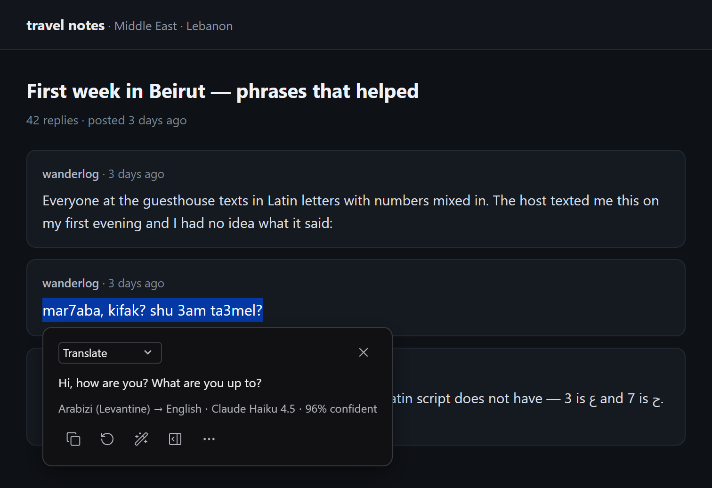
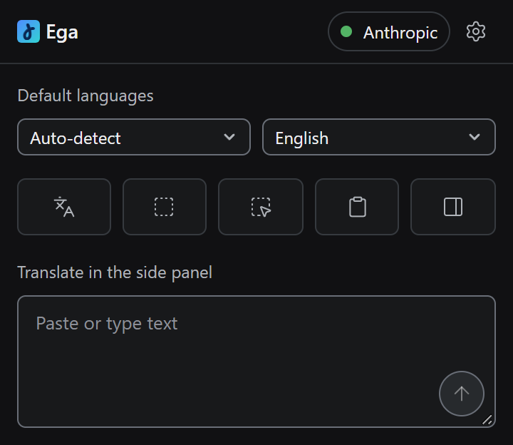
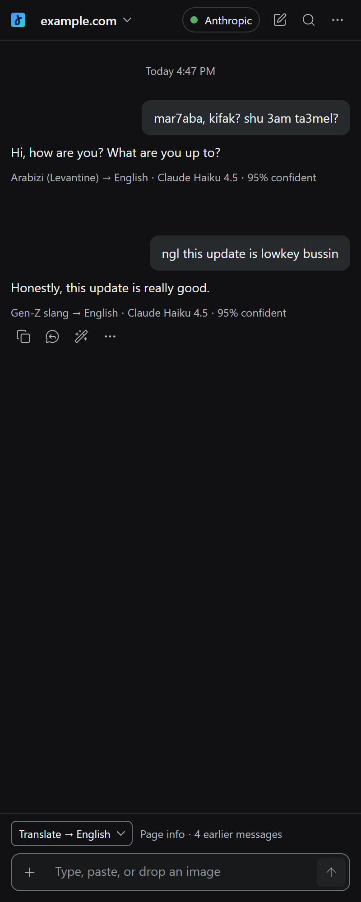
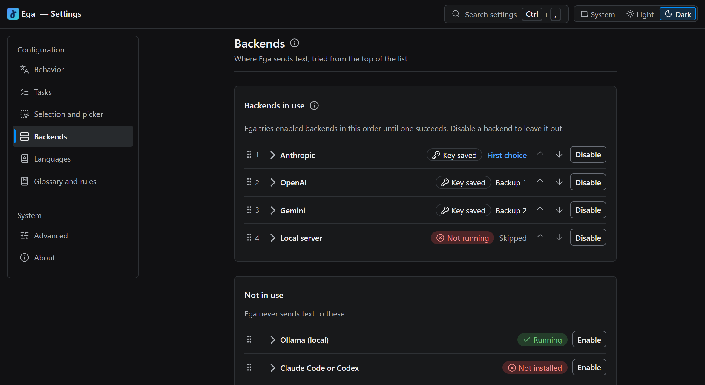

# Ega

> A Chrome extension that translates the text a normal translator gives up on —
> Arabizi, Gen-Z slang, Elvish, jargon from crypto / gaming / medical / legal, and
> any language you define yourself. It routes the selection to an LLM backend you
> choose and own.

**A personal, niche project, vibe-coded for fun.** There is no support, no promised roadmap
and no guarantee. Use it at your own risk, and expect rough edges.

<p align="center">
  
</p>

Select `mar7aba, kifak? shu 3am ta3mel?`, press `Ctrl+Shift+L`, get **Hi, how are you? What are
you up to?** A plain translator usually gives the letters back unchanged.

It is for you if a plain translator cannot handle your language or dialect, you already have an
LLM (a Gemini, Anthropic or OpenAI key, Ollama, LM Studio or llama-server, or a local `claude` /
`codex` CLI), and you want the answer on the page, not in another tab.

## What it does

- **Select text** and a small bubble appears (by default only when the text does not read as plain
  English). Click it, or press the shortcut, and a tooltip streams the answer.
- **Right-click** to translate the whole page, pick one element, or send an image to the side
  panel. **Choose areas** in the popup translates only the parts you pick.
- **Seven tasks:** Translate, Explain, Summarize, Reword, Grammar, Reply ideas and Ask. Explain is
  the one for slang: it says what the text _means_, including the reference a literal translation
  flattens. Write your own tasks with your own reply fields; see four
  [example tasks](docs/custom-tasks.md) you can import in one go.
- **The side panel** keeps your conversations per site: follow-up questions, Refine presets,
  versions of a reply, search and export.

<p align="center">
  
  &nbsp;
  
</p>

## Install

Not on the Chrome Web Store yet. Load it unpacked. You need Node 22.22.2 or newer (24.15 or newer
on the 24 line), pnpm 10 (`corepack enable` picks up the pinned version) and Chrome 123 or newer.

```bash
git clone https://github.com/el-f/ega.git
cd ega
pnpm i --frozen-lockfile && pnpm build
```

Open `chrome://extensions`, turn on **Developer mode**, choose **Load unpacked**, and select the
`dist/` folder. Ega opens its Settings page on a fresh install. Go to **Backends**:

1. **Paste a key into one provider's card.** Google Gemini has a free tier and takes about a
   minute to set up. On the free tier, Google may use and review what you send (see
   [PRIVACY](docs/PRIVACY.md)), and its [Gemini API terms](https://ai.google.dev/gemini-api/terms)
   are for developers and people 18 or older. Read them before you use a key.
2. **Check that the provider sits under Backends in use.** Only Anthropic, Gemini and the native
   host start enabled. Every other provider is never called until you press **Enable** on its card.

Reload a tab you already had open, select text on it and press `Ctrl+Shift+L` (`Cmd+Shift+L` on
macOS). Something not working? See [Troubleshooting](docs/TROUBLESHOOTING.md).

## Backends

Ten cloud providers, two kinds of local server, and a bridge to a CLI you already have.

| Backend             | Kind                                    | What it needs                             | Images        |
| ------------------- | --------------------------------------- | ----------------------------------------- | ------------- |
| Anthropic           | Cloud                                   | An API key                                | Yes           |
| OpenAI              | Cloud                                   | An API key                                | Yes           |
| Google Gemini       | Cloud                                   | An API key                                | Yes           |
| OpenRouter          | Cloud                                   | An API key                                | Yes           |
| Groq                | Cloud                                   | An API key                                | No            |
| DeepSeek            | Cloud                                   | An API key                                | No            |
| Together            | Cloud                                   | An API key                                | No            |
| Mistral             | Cloud                                   | An API key                                | No            |
| xAI                 | Cloud                                   | An API key                                | No            |
| Fireworks           | Cloud                                   | An API key                                | No            |
| Ollama              | Local; a cloud model runs on ollama.com | A daemon on loopback + `ollama pull`      | Vision models |
| Local server        | Local: LM Studio or llama-server        | The server running on loopback, no key    | Vision models |
| `claude` or `codex` | Existing CLI                            | The CLI installed and the host registered | Yes           |

<p align="center">
  
</p>

- **One fallback chain.** Order your enabled backends; when one fails Ega moves to the next. A
  malformed reply, an unsupported request, or a failure after the answer started streaming stops
  the walk instead.
- **Images** skip every backend that cannot read them. On a right-click image with no image-capable
  backend, Ega stops and says so.
- **Cost:** a cloud request is billed to your own key. "Translate page" sends one request per text
  block as you scroll to it, and a failed request can go on to the next backend, which may be paid
  too. Enable only the providers you want Ega to use.
- **The `claude` or `codex` CLI** answers through your existing login, so a plan that includes it
  costs nothing extra; requests count against its usage limits. Set it up with
  [`docs/INSTALL_NATIVE_HOST.md`](docs/INSTALL_NATIVE_HOST.md).

## Make it yours

- **Languages** — define a custom language with a hint for the model and a few examples.
- **Tasks** — edit the prompt of each task, write tasks of your own, and turn off the ones you
  never use. A language can have its own prompt too.
- **Glossary** — pin terms that must always render a certain way.
- **Rules** — plain-language instructions scoped to a task or a site.

## Privacy

Ega has no server, no account and no telemetry. Translation requests go to the backend you
configured. Four other things can leave your browser:

- **Page context**, on by default: the page title, the URL cut to origin and path, and the text
  around your selection. On an image you right-click for Explain or one of your own tasks, it
  carries the text around the image, its alt text and its caption instead. Settings → Behavior →
  **Page context** turns it off.
- **The page's main image, when you press Explain.** The switch is under Page context.
- **The image you right-clicked**, downloaded from the site that hosts it.
- **Your voice, when you dictate** in the side panel (Chrome's speech recognition, a Google service).

Ega asks for every site because the content script runs wherever you select text, and image
translation fetches the picture from whatever origin serves it. Password, payment and
secret-looking fields are skipped. [`PRIVACY.md`](docs/PRIVACY.md) lists every outbound flow,
[`PERMISSIONS.md`](docs/PERMISSIONS.md) every permission, and
[`THREAT_MODEL.md`](docs/THREAT_MODEL.md) what Ega defends against.

## Development

```bash
pnpm i --frozen-lockfile
pnpm test          # vitest
pnpm test:e2e tests/e2e/first-run.spec.ts   # one Playwright spec
pnpm build
```

Commands, gates and test notes: [`docs/DEVELOPMENT.md`](docs/DEVELOPMENT.md).

## Status and license

Version 0.0.2, alpha. The settings schema still changes between versions. Issues, discussions and
outside pull requests are off; you can read the code, use it and fork it.

MIT — see [LICENSE](LICENSE). It covers the original source in this repository. The built
extension bundles third-party packages that keep their own licenses, listed in
[THIRD_PARTY.md](THIRD_PARTY.md), which also ships inside the packaged zip. The app icon is the
letter ע set in [Gveret Levin](https://github.com/AlefAlefAlef/gveret-levin) by AlefAlefAlef,
under the SIL Open Font License 1.1; the font and its license live in `scripts/icon-font/`, and
`pnpm gen:icons --force` redraws the committed PNGs from it.
