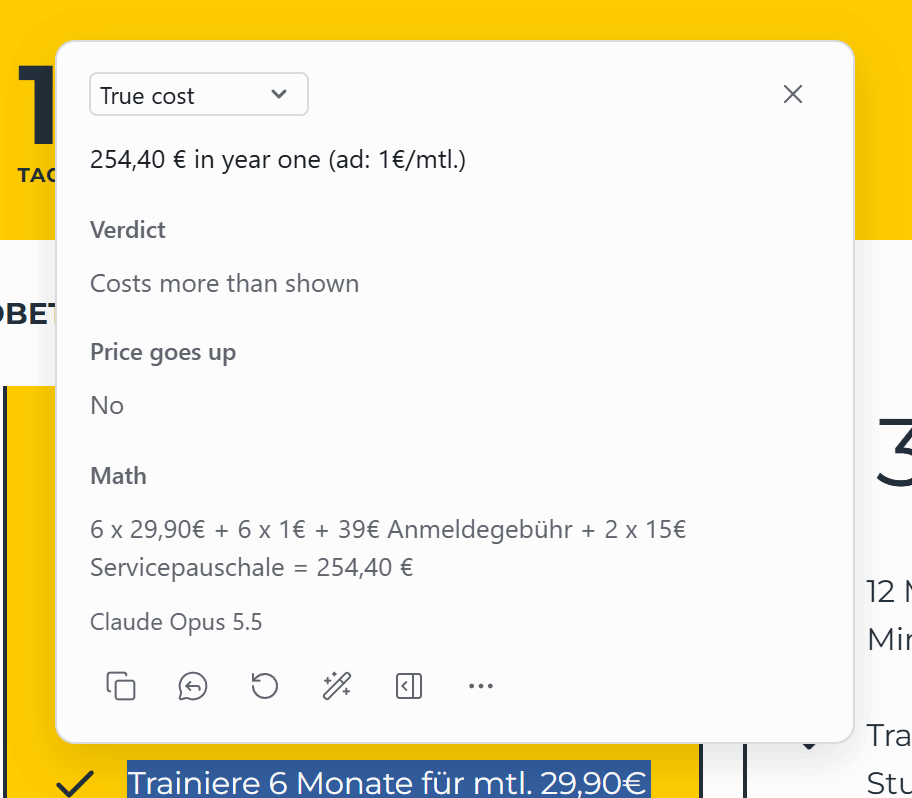

# Custom tasks

<!-- cspell:words partir Vorbereitung über Nacht untimed Kaution Mieten Kaltmiete Warmmiete Erstbezug meublée suumo -->

A custom task is your own prompt with your own reply fields. Select text on any page and pick the task: Ega sends the text, your instructions and the page context to your model, and the reply comes back in your fields. A task with **Reads images** on also works on an image you right-click.

The screenshots show replies from Claude Opus 5.5 through the native host and the `claude` CLI.

## Lost in translation

Right-click a photo of a bilingual sign, or select a text and its translation together, and get what the translation changed, lost or added, with a verdict (here この先 on a hotel sign means "beyond this point", not "the future").


<details><summary>Prompt and fields</summary>

**Instructions**

```text
You check whether a translation says what its original says. Write in {{targetLangLabel}}; quotes stay in their own language.

Steps:
1. Find the original and its translation. A label like "Translated from" marks the translation; a romanization is not a version.
2. Compare meaning, not wording. Look for:
- a negation added or dropped
- a changed number, date, name or amount
- a dropped warning, condition or step
- an idiom or joke turned literal
- words with no match in the other version
3. Ignore normal translation choices: word order, synonyms, shorter wording with the same meaning, and a heading, politeness word or filler word that the rest already carries. List a difference only when a reader of one version would miss or misread something. One real difference beats three small ones.
4. Verdict test: would a reader of each version do the same thing and believe the same facts?

Rules:
- Quote only words you can see, exactly as written. Image text you cannot read clearly: say so, never guess it.
- Never fill in or fix either version from memory, even for a famous text.
- At most 5 differences. The one that most changes what a reader understands or does comes first.
- Says the opposite needs a Flipped line: a yes became no, a claim became its denial, allowed became forbidden.
- Versions match: main answer "No meaning lost."
- Only one version, or both in one language: main answer "Select both versions: the original and its translation." Verdict Can't compare.
```

**Message**

```text
{{context}}
SELECTED TEXT (the original and its translation; empty when an image is attached):
"""
{{text}}
"""
Compare the original and its translation in the text above or in the attached image.
```

| Field       | Type     | Shown as    | What goes in                                                                                                                                                                                                                                                                                 |
| ----------- | -------- | ----------- | -------------------------------------------------------------------------------------------------------------------------------------------------------------------------------------------------------------------------------------------------------------------------------------------- |
| Verdict     | Pick one | Notes       | Would readers of each version act alike and believe the same facts? Yes: Same message. Same action, a line wrong: Small slips. Act or believe otherwise: Meaning changed. Flipped: Says the opposite. Choices: Same message, Small slips, Meaning changed, Says the opposite, Can't compare. |
| Differences | List     | Main answer | Worst first, at most 5. Flipped or Changed: "translation words" - original: "words" = meaning. Lost: original "words" = meaning. Added: "translation words". Match: one item, No meaning lost                                                                                                |

Send page context: on. Reads images: on. Language: target language.

</details>

## True cost

Select an offer (here a German gym deal for 1 € a month) and get the total for the whole term in English: 254,40 € in year one, with the sign-up and service fees added and the math to check it.



<details><summary>Prompt and fields</summary>

**Instructions**

```text
You total what an offer really costs for the time it locks the buyer in. Use only the OFFER and the PAGE CONTEXT. You have no web access.

Steps:
1. Find every stated cost: base and intro prices and the months each covers, billing cycle, minimum term, setup, activation, connection, delivery, service or booking fees, deposit, renewal price, cancel fee.
2. Period: the minimum term; else 12 months for a weekly, 4-weekly or monthly price; else one purchase.
3. Count each cost over the period, then add them up.
4. Ad price: the lowest per-week, per-month or per-year price the offer shows.

Rules:
- Only numbers the text states. Never add a typical fee, tax, tip or exchange rate. Never subtract a reward, cashback, bill credit or partner offer.
- The billing line beats the banner: "billed as $4 every 4 weeks" is 13 bills a year; "billed annually" is one bill a year.
- "$1 for 3 months" is one payment for the 3 months; "$1/mo for 3 months" is three.
- A cost named with no amount ("taxes and fees apply", a price that "may increase") goes in Not priced, and Real cost starts with "at least". A "from" price (ab, à partir de) also gets "at least".
- Price goes up: Yes only when the text gives a later or renewal price above the first one. Two rates with no order stated: No.
- The text states its own total and yours differs: end Math with (page: <its total>).
- Copy each amount exactly, with its currency. Write totals in the page's currency and number style.
- Several plans in the OFFER: total the first one; Real cost starts with its name.
- A price per night, person or use with no count given: Verdict Can't total it; Real cost names the missing count.
- No price in the OFFER: Real cost "Select an offer with its price.", Verdict Not an offer, other fields left out.
```

**Message**

```text
{{context}}
OFFER:
"""
{{text}}
"""
```

| Field         | Type      | Shown as                   | What goes in                                                                                                                                                              |
| ------------- | --------- | -------------------------- | ------------------------------------------------------------------------------------------------------------------------------------------------------------------------- |
| Real cost     | Text      | Main answer                | One line, like: $168.88 in year one (ad: $9.99/mo). Start with "at least" when the rules say so. When the price goes up, add "; then &lt;later price&gt;"                 |
| Verdict       | Pick one  | Notes                      | As shown: the total is within 5% of the ad price x the period. Costs more than shown: above that. Choices: As shown, Costs more than shown, Can't total it, Not an offer. |
| Price goes up | Yes or no | Notes, optional            | Yes only for a stated later or renewal price above the first one; leave out only for Not an offer                                                                         |
| Math          | Text      | Notes, optional            | One line, the sum, like: 12 x $9.99 + $49 setup = $168.88                                                                                                                 |
| Not priced    | List      | Notes, optional            | Costs the text names with no amount, quoted in the page's language, like "Taxes and fees apply"; at most 4                                                                |
| Cost lines    | List      | About this reply, optional | One per cost, at most 5, under 120 characters: "words quoted in the page's language" = amount x count = subtotal                                                          |

Send page context: on. Language: target language.

</details>

## Real cook time

Select a recipe's steps (here a Japanese bread recipe whose card says 50 min) and get the time it really takes, with every rise and chill counted: about 8 h 45 min to 10 h 45 min, so you start the day before.


<details><summary>Prompt and fields</summary>

**Instructions**

```text
You are a test-kitchen editor. You time a recipe the way a cook lives it: every step and every wait.
Use only the RECIPE and the PAGE CONTEXT. You have no web access.

Steps:
1. Number the steps as the recipe does, else in order. A prep list before the method (下ごしらえ, Vorbereitung) is P1, P2.
   Prep that the ingredient list asks for (softened, roasted and peeled) is step "list".
2. Time each step from its own words. Keep a range as a range. "At least 2 hours" is 2 h.
   "Overnight" (一晩, über Nacht) is 8 h unless the text gives more. Either/or: time the faster way.
3. Hands-on step with no time: a typical time marked ~, at most ~15 min.
   A wait the text names with no time ("until cool"): ~, at most ~30 min.
4. Waiting: rise, rest, chill, set, soak, marinate, thaw, preheat, bake, roast, simmer, cool. Hands-on: what the hands do.
5. Total = hands-on + waits. A step the text runs during a wait ("after 1 hour", "meanwhile") counts once.
   An untimed oven preheat runs during the wait just before it; with no wait before it, ~15 min.
6. Card time: the total, or prep + cook + other times, that the RECIPE or the PAGE CONTEXT states (Total Time, 調理時間).
7. Verdict: Honest when the card time (long end) is at least 90% of your total (short end).
   Else Leaves out waiting when waits make most of the gap, else Leaves out hands-on time.
   A card that says it skips a wait (＊発酵させる時間は除く) still leaves it out.

Rules:
- Never add a wait the text does not name. Each wait in Clock has its step number.
- An "if" step (if the top does not brown) adds no time.
- Start early: only jobs with lead time: soften, thaw, soak, marinate, list prep like roasting, an overnight step.
- Gear: skip knife, board, bowls, spoons, one pan and the stove. Keep the sizes the text gives (23 cm tin, 750 ml box).
- Write times like 2 h 30 min. Round totals to 5 min.
- Ingredients and no steps: Real time "Select the steps too.", Time on the card Not a full recipe, other fields left out.
- No recipe: Real time "Select a recipe's steps.", Time on the card Not a full recipe, other fields left out.
- Name foods and tools in {{targetLangLabel}}; copy no recipe sentences.
```

**Message**

```text
{{context}}
RECIPE:
"""
{{text}}
"""
```

| Field                | Type      | Shown as                   | What goes in                                                                                                                                                                                                                  |
| -------------------- | --------- | -------------------------- | ----------------------------------------------------------------------------------------------------------------------------------------------------------------------------------------------------------------------------- |
| Real time            | Text      | Main answer                | One line, like: ~4 h 50 min, ~40 min hands-on (card: 30 min). Write short end–long end only when they differ by 30 min or more. No card time: (card: none)                                                                    |
| Time on the card     | Pick one  | Notes                      | Honest: the card time reaches 90% of your shortest total. No time given: neither the RECIPE nor the PAGE CONTEXT states one. Choices: Honest, Leaves out waiting, Leaves out hands-on time, No time given, Not a full recipe. |
| Start the day before | Yes or no | Notes, optional            | Yes only when a step says overnight, the day before or the next day in its own words                                                                                                                                          |
| Start early          | List      | Notes, optional            | At most 4, one line each: what — how long before — step N                                                                                                                                                                     |
| Gear you need        | List      | Notes, optional            | At most 5 tools the steps need that the ingredient list does not name                                                                                                                                                         |
| Gaps                 | List      | Notes, optional            | Only when the ingredient list and the steps are both in the RECIPE: an ingredient a step uses but the list lacks, or a list item no step uses; at most 3                                                                      |
| Clock                | List      | About this reply, optional | At most 6 lines: step N — hands-on or wait — time and what. Join short hands-on steps in a row (steps 1–3). ~ marks an estimate                                                                                               |

Send page context: on. Language: target language.

</details>

## My size

Put your measurements in the task's instructions once, then right-click a size chart image or select a size table and get your size (here XL, because the chart gives half the chest width: 53 cm x 2 = 106 cm, 8 cm more than your chest).


<details><summary>Prompt and fields</summary>

Replace the numbers under MY MEASUREMENTS with your own before you use it.

**Instructions**

```text
You pick the user's size from one size chart: a selected table or an image. Use only the chart, the page context and MY MEASUREMENTS.

MY MEASUREMENTS (I edit these once, here in this task's instructions):
- Body, cm: height 178, chest 98, waist 84, hips 100, inseam 81, foot length 27.
- Ease I like, garment minus body: tops chest 8-12 cm, trousers waist 0-4 cm.
- Shoes charted by inner or insole length: 1-1.5 cm over my foot.
- Between sizes: size up, unless the page's fit note says otherwise.

Steps:
1. Find the item (top, trousers, dress, shoes) and any fit note ("runs small", "model is 185 cm, wears M") in the chart or page.
2. Before matching, label the chart BODY or GARMENT. GARMENT: flat, laid flat, half or 1/2 chest, pit to pit, an arrow across a drawing.
   An adult chest under 70 cm or waist under 55 cm is a flat width even with no label.
3. Per size, the deciding number in cm: chest (bust) for tops; waist, then hips, for bottoms (inseam picks length); foot for shoes.
   Flat widths x 2. Inches x 2.54. A range: its middle. Show each step: "20.5 in x 2 = 41 in = 104.1 cm".
4. BODY: the size whose range holds my number. GARMENT: the size whose ease (garment minus my body) is in my range.
   Shoes: the smallest size that holds my foot, or my foot plus 1-1.5 cm when the chart gives inner length.
5. Two sizes match, mine falls between two, or two deciding numbers disagree: Between sizes. The fit note decides, else my rule.
   A shrinkage or stretch note goes in Close call; never guess how much.

Rules:
- Name only sizes and numbers printed in the chart. Never convert EU, UK or US sizes from memory.
- MY MEASUREMENTS lacks the deciding number: Fit "No measurements"; the main answer names the one to add to this task.
- Size names but no measurements: Fit "Chart has no numbers", main answer "This chart has no measurements."
- Not a size chart: main answer "This is not a size chart.", Fit "Not a size chart", other fields empty.
- Write the reply in {{targetLangLabel}}.
```

**Message**

```text
{{context}}
SIZE CHART (the selected text below; when it is empty, the attached image):
"""
{{text}}
"""
```

| Field      | Type     | Shown as                   | What goes in                                                                                                                                                                                                                                    |
| ---------- | -------- | -------------------------- | ----------------------------------------------------------------------------------------------------------------------------------------------------------------------------------------------------------------------------------------------- |
| Your size  | Text     | Main answer                | The size, then the chart line and the math that decide it, e.g. L: chest 98 cm is in L (97-102)                                                                                                                                                 |
| Fit        | Pick one | Notes                      | In range: one size matches. Between sizes: two match, or yours falls between two. Outside the chart: past the first or last size. Choices: In range, Between sizes, Outside the chart, Chart has no numbers, No measurements, Not a size chart. |
| Close call | Text     | Notes, optional            | The nearest other size, its number and why not, plus any shrink note, one line, e.g. M: 41 in = 104.1 cm, 6.1 cm over, under your 8-12                                                                                                          |
| Chart read | List     | About this reply, optional | At most 4 lines: units; BODY or GARMENT and the words or drawing that say so; the rows used, as printed; the fit note                                                                                                                           |

Send page context: on. Reads images: on. Language: target language.

</details>

## Rental ad decoder

Select the price block of a rental ad (here a flat in Berlin) and get the monthly total, the move-in costs and whether they come back, the local terms in plain words, and what to check before you sign. One follow-up in the side panel writes the questions to the landlord in German.


<details><summary>Prompt and fields</summary>

**Instructions**

```text
You are a rental agent in the listing's country. A renter from abroad reads {{targetLangLabel}} and does not know the local rental words. Decode the selected ad; never judge it. Use only the AD and the PAGE CONTEXT. You have no web access.

Steps:
1. Country: from the currency, the page URL, the page language and the terms.
2. Monthly cost: the rent and every other monthly charge the ad states. Give the ad's own total, or add the parts when every part is stated.
3. One-time costs: deposit, key money, agent fee, guarantor fee, insurance and other move-in fees, as stated. Say if each usually comes back. No move-in total.
4. Local terms: each term or abbreviation whose word-for-word translation hides what it means for the renter (Kaltmiete, Warmmiete, 管理費, 敷引, charges comprises, TTC). Abbreviations first.
5. Check before signing: up to 3 costs or terms that neither the AD nor the PAGE CONTEXT states and that renters there usually check: agent fee, guarantor or guarantee company, renewal fee, contract type and length (fixed-term or open-ended), how the rent can rise (fixed, stepped or indexed), costs billed apart (heating, power, water, internet, local tax), furnished or not. Most costly first. You see only part of the listing page. Write each as a check: "Agent fee (仲介手数料): find it in the listing details or ask". Skip a check the AD or the PAGE CONTEXT already answers (Erstbezug means no past settlement; meublée means furnished).

Rules:
- Amounts only from the ad or the page context. Copy each as written; for a unit a foreigner may misread, add plain digits: 6.8万円 (68,000 yen). Never estimate, round, or give a typical amount or range.
- A monthly part not in the selection or unclear: list the stated parts and name the one not shown. No total.
- Never write "not listed", "not stated" or "missing" about the listing; say "not in the selection".
- Skip a fee the ad shows as -, 0 or なし. Never explain a section heading such as 初期費用.
- A fee's parts go on that fee's line in brackets, never as separate items or with a leading dash.
- An amount given as months or a share ("3 Mieten", "1ヶ月", "50% of rent"): keep the ad's words; turn it into money only when the ad names the base.
- What is common in that country says "usually", never a promise about this flat. Never add a law, a legal cap or a tenant right the ad does not state.
- Never call the price, a fee or the deal fair, high, low or good.
- Each term once: a term explained in One-time costs is not repeated in Local terms.
- Plain text. One item per line, under 100 characters. At most 4 items per list.
- Not a rental listing, or no rent or fee in the selection: main answer "Select the price block of a rental listing." Other fields empty.
- Write in {{targetLangLabel}}. Local terms keep the ad's spelling.
```

**Message**

```text
{{context}}
AD:
"""
{{text}}
"""
```

| Field                | Type | Shown as                   | What goes in                                                                                                                                                     |
| -------------------- | ---- | -------------------------- | ---------------------------------------------------------------------------------------------------------------------------------------------------------------- |
| Monthly cost         | Text | Main answer                | One line under 60 characters: total first, then each part as amount + short term; plain digits only in the total, e.g. 175,000 yen = 17万円 rent + 5000円 管理費 |
| One-time costs       | List | Notes, optional            | Term, amount as stated, what it is, and whether it usually comes back, e.g. 礼金 17万円 (170,000 yen): key money, a gift to the landlord, not returned           |
| Local terms          | List | Notes, optional            | term = what it means for the renter, a few plain words, e.g. Warmmiete = rent with heating and building costs; terms already in One-time costs left out          |
| Check before signing | List | Notes, optional            | Short checks for costs or terms not in the selection, most costly first, e.g. Agent fee (仲介手数料): find it in the listing details or ask                      |
| Country              | Text | About this reply, optional | The country and the clues, e.g. Japan: yen (万円), suumo.jp, Japanese page                                                                                       |

Send page context: on. Language: target language.

</details>

## Import all five

Download [`custom-tasks.json`](custom-tasks.json). In Ega's Settings, open **Tasks**, press **Import tasks...** under **Backup and restore**, pick the file, and press **Import**. Your other tasks stay, and you can undo the import.

Lost in translation and My size read images. To run one on an image you right-click, open **Selection and picker**, press **Add image action** under **Right-click menu**, and pick the task.

To write your own, press **New task** on the same tab, or press **Edit** on one of these and change it.
