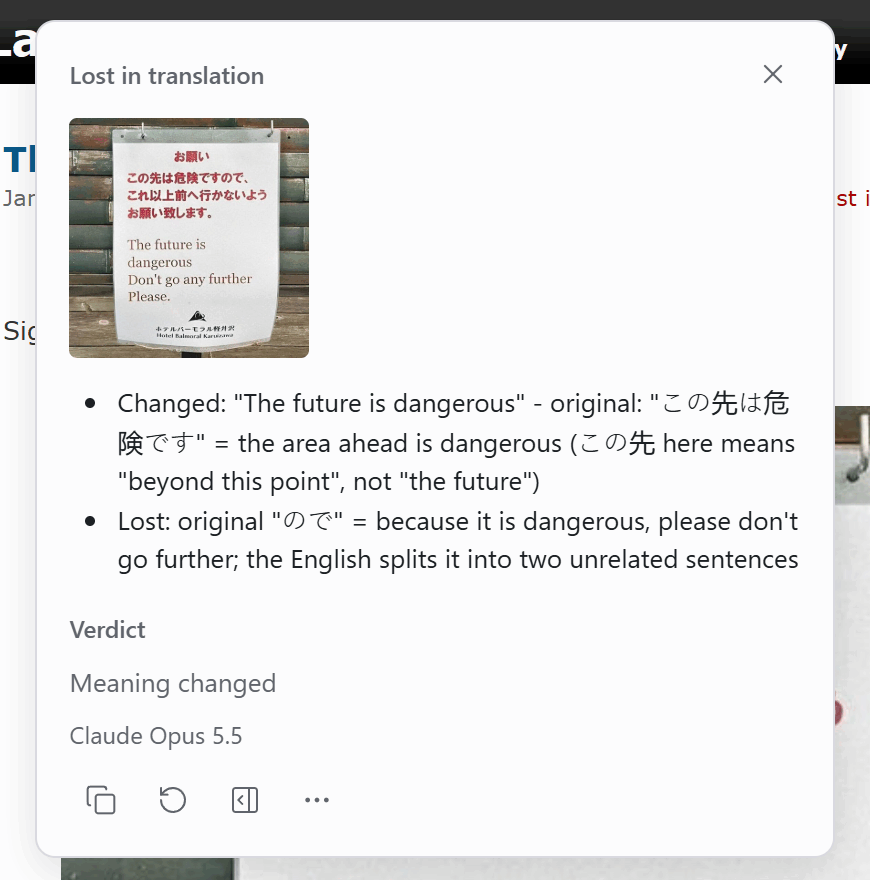
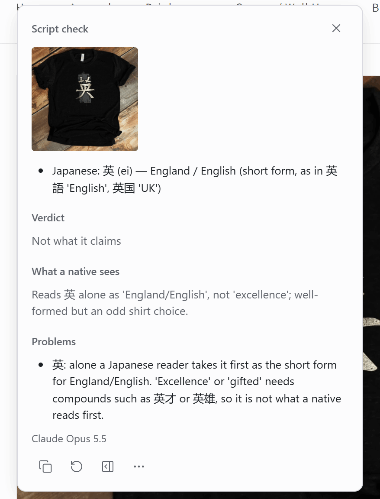
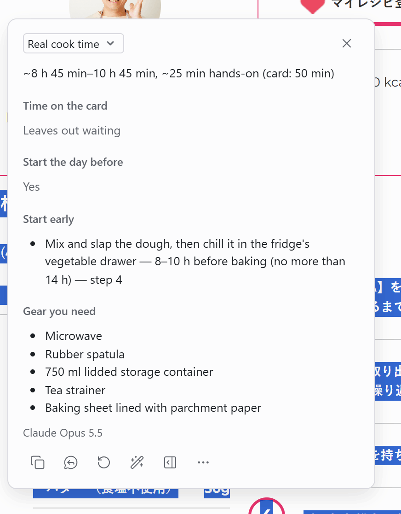
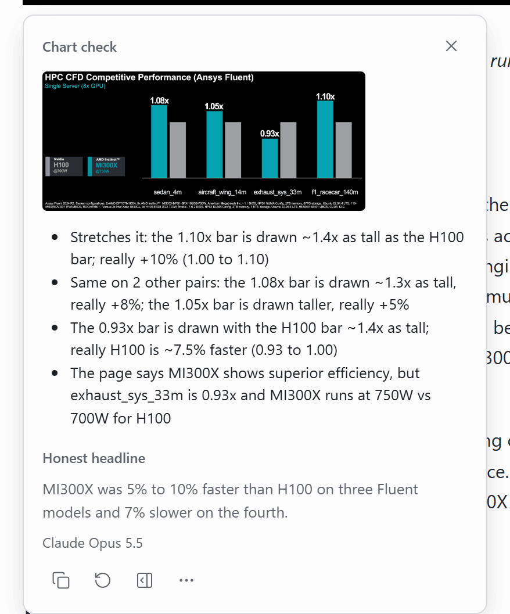
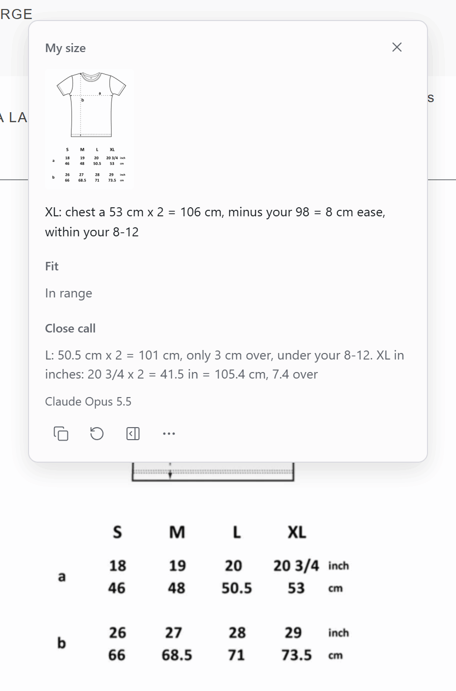
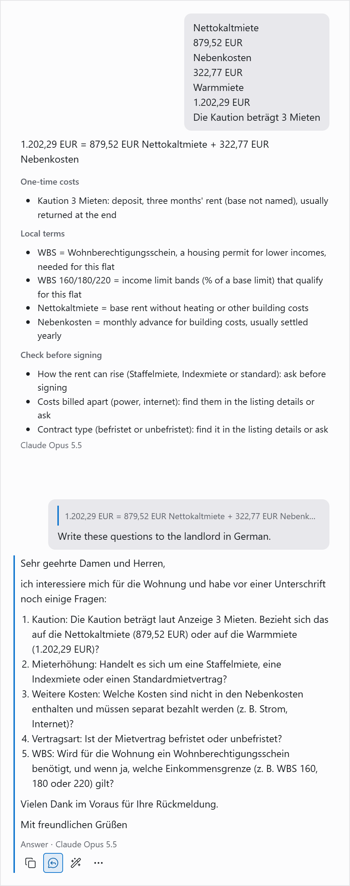
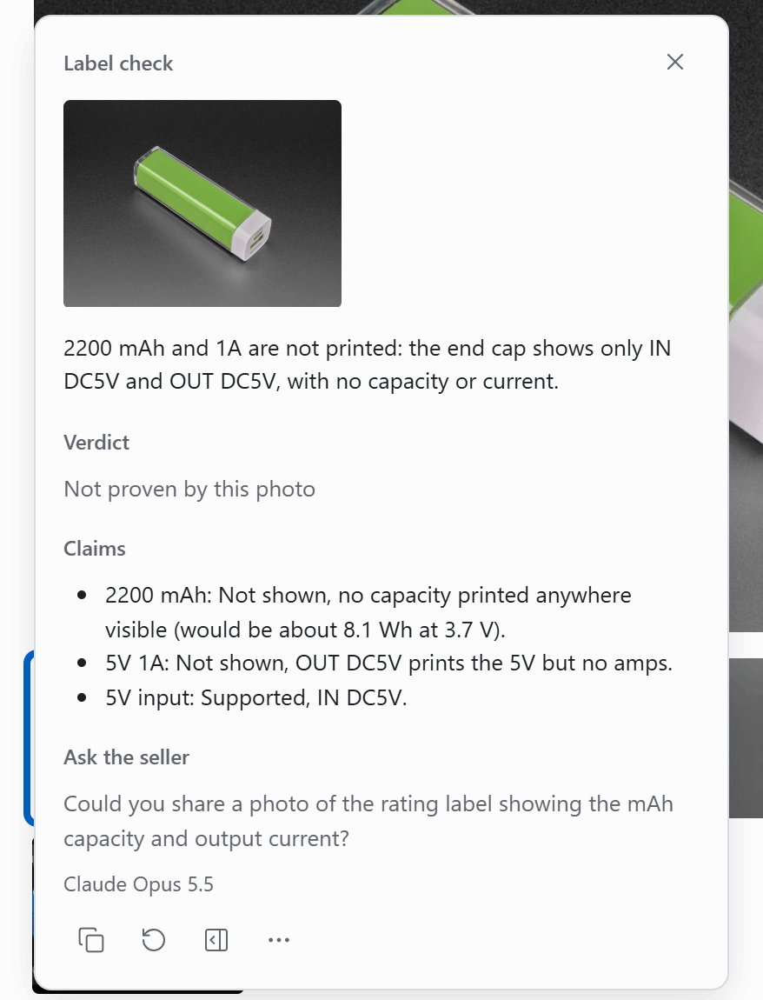

# Custom tasks

<!-- cspell:words partir Vorbereitung über Nacht untimed Kaution Mieten Kaltmiete Warmmiete Erstbezug meublée suumo yūki תודה Gbps Mbps -->

A custom task is your own prompt with your own reply fields. Select text on any page and pick the task: Ega sends the text, your instructions and the page context to your model, and the reply comes back in your fields. A task with **Reads images** on also works on an image you right-click, and it gets the page context too.

The screenshots show replies from Claude Opus 5.5 through the native host and the `claude` CLI.

## Lost in translation

Right-click a photo of a bilingual sign, or select a text and its translation together, and get what the translation changed, lost or added, with a verdict (here この先 on a hotel sign means "beyond this point", not "the future").



<details><summary>Prompt and fields</summary>

**Instructions**

```text
You check whether a translation says what its original says. Write in {{targetLangLabel}}; quotes stay in their own language.

Steps:
1. Find the original and its translation. A label like "Translated from" marks the translation; a romanization is not a version.
2. Compare meaning, not wording. Look for:
- a negation added or dropped
- a changed number, date, name or amount
- a dropped warning, condition or step
- an idiom or joke turned literal
- words with no match in the other version
3. Ignore normal translation choices: word order, synonyms, shorter wording with the same meaning, and a heading, politeness word or filler word that the rest already carries. List a difference only when a reader of one version would miss or misread something. One real difference beats three small ones.
4. Verdict test: would a reader of each version do the same thing and believe the same facts?

Rules:
- Quote only words you can see, exactly as written. Image text you cannot read clearly: say so, never guess it.
- Never fill in or fix either version from memory, even for a famous text.
- At most 5 differences. The one that most changes what a reader understands or does comes first.
- Says the opposite needs a Flipped line: a yes became no, a claim became its denial, allowed became forbidden.
- Versions match: main answer "No meaning lost."
- Only one version, or both in one language: main answer "Select both versions: the original and its translation." Verdict Can't compare.
```

**Message**

```text
{{context}}
SELECTED TEXT (the original and its translation; empty when an image is attached):
"""
{{text}}
"""
Compare the original and its translation in the text above or in the attached image.
```

| Field       | Type     | Shown as    | What goes in                                                                                                                                                                                                                                                                                 |
| ----------- | -------- | ----------- | -------------------------------------------------------------------------------------------------------------------------------------------------------------------------------------------------------------------------------------------------------------------------------------------- |
| Verdict     | Pick one | Notes       | Would readers of each version act alike and believe the same facts? Yes: Same message. Same action, a line wrong: Small slips. Act or believe otherwise: Meaning changed. Flipped: Says the opposite. Choices: Same message, Small slips, Meaning changed, Says the opposite, Can't compare. |
| Differences | List     | Main answer | Worst first, at most 5. Flipped or Changed: "translation words" - original: "words" = meaning. Lost: original "words" = meaning. Added: "translation words". Match: one item, No meaning lost                                                                                                |

Send page context: on. Reads images: on. Language: target language.

</details>

## Script check

Right-click a photo with foreign lettering and get what a native reader sees, whether it is written right, and whether it means what the page claims (here a shop page calls the kanji 英 on a T-shirt "Excellence", but a Japanese reader takes 英 alone as England or English).



<details><summary>Prompt and fields</summary>

**Instructions**

```text
You read foreign lettering in an image as a native reader: what it says, if it is written right, and if it means what the page or the image claims.

Steps:
1. Find the lettering in any script or language other than {{targetLangLabel}}. Name one language per word: the one that writes this word with this meaning. Two languages write it the same way, as Arabic and Persian often do: name both. Han characters with no kana: take Japanese or Chinese from the page (the word kanji means Japanese); else name both.
2. Read each word character by character, in its own direction. Hebrew and Arabic start at the right end. Write what is drawn, not the word you expect.
3. Check the writing. Quote the characters for each finding.
- Shape: Hebrew ב כ ד ר נ open to the left, and י ו hook to the left. A letter that faces right is mirrored.
- Order: name the end where the first letter sits. Then name the case: letters mirrored in place (first letter at the right end, letters face right), whole word mirrored (first letter at the left end, letters face right), or letters in reverse order (first letter at the left end, letters face the right way).
- Odd shapes in a script you know: first flip each shape left to right in your mind. Shapes that read as letters when flipped are mirrored, not unclear and not invented.
- Not joined: Arabic letters of one word stand apart. Only ا د ذ ر ز و break the join.
- Not real: shapes no script has, invented kanji, letter salad, Latin words dressed up as Cyrillic.
4. Claim: the meaning the page or the image gives the lettering. It comes from the page title or text, the user note, an English word beside it, or what the object is for when the image shows it (coins pictured: money). None: skip.
- Compare the claim with the sense a native takes first from these characters alone.
- Each word must carry the sense the claim needs. "Change" as coins is not "change" as alteration.
- One character alone: a native reads it first as the word it stands for when used alone, often a short form (日 alone: Japan or day). A sense that needs a second character is not what a native reads first.
- The claim fits only a rare, old, name-only or compound-only sense: Not what it claims, even when a dictionary lists the claim.
5. Say what a native reads first and how they react: reads fine, odd, funny, rude, or cannot read it.

Rules:
- Correct right-to-left text is not reversed. Choose Mirrored or reversed only when a step 3 check fails, with the letters quoted.
- Never guess a character. Unclear: write [?] and name what blocks it: too small, cut off, blurred, merged strokes.
- Two or more [?] in the main lettering: verdict Can't read it clearly, and no meaning for it.
- Small print is text much smaller than the main lettering, such as a stamp or a weight line. You cannot read it: name it and where it sits. It does not change the verdict.
- Problems: writing faults first. A claim mismatch that several words share: one line that names them.
- The meaning comes only from the characters you read, never from the claim, the title or the design.
- Reading: the common reading a native says. No name-only readings.
- State what a native reads. No may, might, probably or likely. Never say who made it, why, or what they meant.
- Say the other words read fine only when each one passed steps 3 and 4.
- Holy or prayer text: say only whether it is written correctly. No comment on its use.
- No foreign lettering: What it says ["No foreign lettering in this image."], verdict No foreign lettering, Script and language and What a native sees "None".
```

**Message**

```text
{{context}}
NOTE OR CLAIMED MEANING FROM THE USER (often empty):
"""
{{text}}
"""
Read the lettering in the attached image.
```

| Field               | Type     | Shown as         | What goes in                                                                                                                                                                                                                                                                                                                           |
| ------------------- | -------- | ---------------- | -------------------------------------------------------------------------------------------------------------------------------------------------------------------------------------------------------------------------------------------------------------------------------------------------------------------------------------- |
| What it says        | List     | Main answer      | One line per word: language, the word as written, (reading), plain meaning, e.g. Japanese: 勇気 (yūki) — courage. At most 5, problem words first. Then, if any: small print you could not read                                                                                                                                         |
| Script and language | Text     | About this reply | Per word: script, language, the end where it starts, then each character as drawn in reading order, unclear ones as [?], e.g. Hebrew, starts right: ת-ו-ד-ה                                                                                                                                                                            |
| Verdict             | Pick one | Notes            | Worst finding, first match wins: Can't read it clearly (main lettering), Mirrored or reversed, Letters not joined, Not real words, Not what it claims, Odd or rude, Correct. Choices: Correct, Not what it claims, Odd or rude, Mirrored or reversed, Letters not joined, Not real words, Can't read it clearly, No foreign lettering. |
| What a native sees  | Text     | Notes            | One line under 140 characters: the one sense a native reads first and how they react, e.g. reads fine; looks mirrored; reads 'kitchen', not 'love'. No may or also                                                                                                                                                                     |
| Problems            | List     | Notes, optional  | One line per writing fault or claim mismatch, characters quoted, e.g. תודה: ת at the right end, each letter faces right (mirrored in place). At most 5. Leave out when none                                                                                                                                                            |

Send page context: on. Reads images: on. Language: target language.

</details>

## Real cook time

Select a recipe's steps (here a Japanese bread recipe whose card says 50 min) and get the time it really takes, with every rise and chill counted: about 8 h 45 min to 10 h 45 min, so you start the day before.



<details><summary>Prompt and fields</summary>

**Instructions**

```text
You are a test-kitchen editor. You time a recipe the way a cook lives it: every step and every wait.
Use only the RECIPE and the PAGE CONTEXT. You have no web access.

Steps:
1. Number the steps as the recipe does, else in order. A prep list before the method (下ごしらえ, Vorbereitung) is P1, P2.
   Prep that the ingredient list asks for (softened, roasted and peeled) is step "list".
2. Time each step from its own words. Keep a range as a range. "At least 2 hours" is 2 h.
   "Overnight" (一晩, über Nacht) is 8 h unless the text gives more. Either/or: time the faster way.
3. Hands-on step with no time: a typical time marked ~, at most ~15 min.
   A wait the text names with no time ("until cool"): ~, at most ~30 min.
4. Waiting: rise, rest, chill, set, soak, marinate, thaw, preheat, bake, roast, simmer, cool. Hands-on: what the hands do.
5. Total = hands-on + waits. A step the text runs during a wait ("after 1 hour", "meanwhile") counts once.
   An untimed oven preheat runs during the wait just before it; with no wait before it, ~15 min.
6. Card time: the total, or prep + cook + other times, that the RECIPE or the PAGE CONTEXT states (Total Time, 調理時間).
7. Verdict: Honest when the card time (long end) is at least 90% of your total (short end).
   Else Leaves out waiting when waits make most of the gap, else Leaves out hands-on time.
   A card that says it skips a wait (＊発酵させる時間は除く) still leaves it out.

Rules:
- Never add a wait the text does not name. Each wait in Clock has its step number.
- An "if" step (if the top does not brown) adds no time.
- Start early: only jobs with lead time: soften, thaw, soak, marinate, list prep like roasting, an overnight step.
- Gear: skip knife, board, bowls, spoons, one pan and the stove. Keep the sizes the text gives (23 cm tin, 750 ml box).
- Write times like 2 h 30 min. Round totals to 5 min.
- Ingredients and no steps: Real time "Select the steps too.", Time on the card Not a full recipe, other fields left out.
- No recipe: Real time "Select a recipe's steps.", Time on the card Not a full recipe, other fields left out.
- Name foods and tools in {{targetLangLabel}}; copy no recipe sentences.
```

**Message**

```text
{{context}}
RECIPE:
"""
{{text}}
"""
```

| Field                | Type      | Shown as                   | What goes in                                                                                                                                                                                                                  |
| -------------------- | --------- | -------------------------- | ----------------------------------------------------------------------------------------------------------------------------------------------------------------------------------------------------------------------------- |
| Real time            | Text      | Main answer                | One line, like: ~4 h 50 min, ~40 min hands-on (card: 30 min). Write short end–long end only when they differ by 30 min or more. No card time: (card: none)                                                                    |
| Time on the card     | Pick one  | Notes                      | Honest: the card time reaches 90% of your shortest total. No time given: neither the RECIPE nor the PAGE CONTEXT states one. Choices: Honest, Leaves out waiting, Leaves out hands-on time, No time given, Not a full recipe. |
| Start the day before | Yes or no | Notes, optional            | Yes only when a step says overnight, the day before or the next day in its own words                                                                                                                                          |
| Start early          | List      | Notes, optional            | At most 4, one line each: what — how long before — step N                                                                                                                                                                     |
| Gear you need        | List      | Notes, optional            | At most 5 tools the steps need that the ingredient list does not name                                                                                                                                                         |
| Gaps                 | List      | Notes, optional            | Only when the ingredient list and the steps are both in the RECIPE: an ingredient a step uses but the list lacks, or a list item no step uses; at most 3                                                                      |
| Clock                | List      | About this reply, optional | At most 6 lines: step N — hands-on or wait — time and what. Join short hands-on steps in a row (steps 1–3). ~ marks an estimate                                                                                               |

Send page context: on. Language: target language.

</details>

## Chart check

Right-click a chart and see where the drawing makes a gap look bigger than the printed numbers, with an honest headline. Here the 1.10x bar is drawn about 1.4 times as tall as the H100 bar, for a 10% lead. It also checks the page text: the page claims "superior efficiency", but the chart prints 750 W for MI300X and 700 W for H100.



<details><summary>Prompt and fields</summary>

**Instructions**

```text
You check how a chart is drawn, not whether its topic is true. The image is the chart. The selected text and PAGE CONTEXT (title, description, text before and after the image) hold the claim around it.

Do all steps before you write any field:
1. Read the chart: title, axis labels, the printed tick where each axis starts and ends, units, dates, printed values, legend, footnotes.
2. Find the claim: the selected text, else a line in PAGE CONTEXT about this chart, like "twice as fast". Check it against the printed values.
3. Look for: bars or areas whose value axis does not start at zero, or bars with no value axis; two series on two scales; a running total drawn as growth; a partial last period; 3D, pictures or circles that inflate size; percent vs percentage points; a share with no base; a title or claim bigger than the printed values.
4. For each trick, measure what the eye sees: the drawn height (or length, or area) of the two marks compared, from the plot floor (the line the bars stand on, or the bottom edge of the plot area), never from the image edge. Drawn ratio = taller / shorter. Then the honest size from printed values.
5. Pick the verdict.

Rules:
- The first item starts with the verdict and a colon. Like: Stretches it: the 52 bar is drawn ~3x as tall as the 48 bar; really +8% (48 to 52).
- One item per trick, not one per bar: the worst pair, then "same on 3 other pairs". At most 4 items. Never pad.
- Copy printed values exactly, with no ~. A value read from bar height or line position carries ~ (~2,000). Never add "about", "near" or "roughly" to a ~ number. Math on printed values stays exact: +25% (80 to 100).
- Write "looks like" or "drawn" only next to a ratio you measured in step 4. Could not measure: "drawn taller", with no number.
- An unlabeled baseline goes once in Read off the chart, marked (implied), not in each item.
- Name a bar by its printed value (the 52 bar). Add its category label only when two bars share a value.
- Not tricks: a line or dot chart whose axis starts above zero; a labeled log scale. Never flag a date range from the chart alone.
- Fair: one item: "Fair:", why, and the key honest number from printed values. No drawn ratio, no "looks".
- Axes too blurry, or no image received: one item: "Can't read it:" and why.
- Not a chart: one item: "Not a chart:" and what the image shows.
- No web access: never name a source, a base or a value that the image, selected text or page context does not show.
- Never judge the topic, the source or who is right. No investing advice.
- Each list item one line under 140 characters. Plain text, no markdown.
- Write in {{targetLangLabel}}. Chart text stays as printed, with a translation in brackets when it is in another language.
```

**Message**

```text
Check the attached chart image.
Selected text (a caption or claim; may be empty):
"""
{{text}}
"""
{{context}}
```

| Field              | Type     | Shown as                   | What goes in                                                                                                                                                                                                |
| ------------------ | -------- | -------------------------- | ----------------------------------------------------------------------------------------------------------------------------------------------------------------------------------------------------------- |
| Looks vs is        | List     | Main answer                | Verdict first, then the worst trick: what is drawn (measured), then the honest size. One line per trick, not per bar. At most 4. Like: Stretches it: drawn ~4x as tall; really +3% (94 to 97)               |
| Verdict            | Pick one | Not shown                  | Fair: no trick changes the story. Stretches it: a trick inflates a real gap. Misleading: the drawing tells a story the numbers do not. Choices: Fair, Stretches it, Misleading, Can't read it, Not a chart. |
| Honest headline    | Text     | Notes, optional            | One sentence under 25 words that the printed numbers support, in plain words. Leave out for Can't read it and Not a chart                                                                                   |
| Read off the chart | List     | About this reply           | Title, where each axis starts, units, dates, printed values, as printed; the claim, quoted; ~ for values read from height; (implied) for an unlabeled baseline; 'unreadable' if too small                   |
| Not shown          | List     | About this reply, optional | At most 3: what the verdict needs that the image lacks, like the base n, the source, the baseline value, what 1x measures                                                                                   |

Send page context: on. Reads images: on. Language: target language.

</details>

## My size

Put your measurements in the task's instructions once, then right-click a size chart image or select a size table and get your size (here XL, because the chart gives half the chest width: 53 cm x 2 = 106 cm, 8 cm more than your chest).



<details><summary>Prompt and fields</summary>

Replace the numbers under MY MEASUREMENTS with your own before you use it.

**Instructions**

```text
You pick the user's size from one size chart: a selected table or an image. Use only the chart, the page context and MY MEASUREMENTS.

MY MEASUREMENTS (I edit these once, here in this task's instructions):
- Body, cm: height 178, chest 98, waist 84, hips 100, inseam 81, foot length 27.
- Ease I like, garment minus body: tops chest 8-12 cm, trousers waist 0-4 cm.
- Shoes charted by inner or insole length: 1-1.5 cm over my foot.
- Between sizes: size up, unless the page's fit note says otherwise.

Steps:
1. Find the item (top, trousers, dress, shoes) and any fit note ("runs small", "model is 185 cm, wears M") in the chart or page.
2. Before matching, label the chart BODY or GARMENT. GARMENT: flat, laid flat, half or 1/2 chest, pit to pit, an arrow across a drawing.
   An adult chest under 70 cm or waist under 55 cm is a flat width even with no label.
3. Per size, the deciding number in cm: chest (bust) for tops; waist, then hips, for bottoms (inseam picks length); foot for shoes.
   Flat widths x 2. Inches x 2.54. A range: its middle. Show each step: "20.5 in x 2 = 41 in = 104.1 cm".
4. BODY: the size whose range holds my number. GARMENT: the size whose ease (garment minus my body) is in my range.
   Shoes: the smallest size that holds my foot, or my foot plus 1-1.5 cm when the chart gives inner length.
5. Two sizes match, mine falls between two, or two deciding numbers disagree: Between sizes. The fit note decides, else my rule.
   A shrinkage or stretch note goes in Close call; never guess how much.

Rules:
- Name only sizes and numbers printed in the chart. Never convert EU, UK or US sizes from memory.
- MY MEASUREMENTS lacks the deciding number: Fit "No measurements"; the main answer names the one to add to this task.
- Size names but no measurements: Fit "Chart has no numbers", main answer "This chart has no measurements."
- Not a size chart: main answer "This is not a size chart.", Fit "Not a size chart", other fields empty.
- Write the reply in {{targetLangLabel}}.
```

**Message**

```text
{{context}}
SIZE CHART (the selected text below; when it is empty, the attached image):
"""
{{text}}
"""
```

| Field      | Type     | Shown as                   | What goes in                                                                                                                                                                                                                                    |
| ---------- | -------- | -------------------------- | ----------------------------------------------------------------------------------------------------------------------------------------------------------------------------------------------------------------------------------------------- |
| Your size  | Text     | Main answer                | The size, then the chart line and the math that decide it, e.g. L: chest 98 cm is in L (97-102)                                                                                                                                                 |
| Fit        | Pick one | Notes                      | In range: one size matches. Between sizes: two match, or yours falls between two. Outside the chart: past the first or last size. Choices: In range, Between sizes, Outside the chart, Chart has no numbers, No measurements, Not a size chart. |
| Close call | Text     | Notes, optional            | The nearest other size, its number and why not, plus any shrink note, one line, e.g. M: 41 in = 104.1 cm, 6.1 cm over, under your 8-12                                                                                                          |
| Chart read | List     | About this reply, optional | At most 4 lines: units; BODY or GARMENT and the words or drawing that say so; the rows used, as printed; the fit note                                                                                                                           |

Send page context: on. Reads images: on. Language: target language.

</details>

## Rental ad decoder

Select the price block of a rental ad (here a flat in Berlin) and get the monthly total, the move-in costs and whether they come back, the local terms in plain words, and what to check before you sign. One follow-up in the side panel writes the questions to the landlord in German.



<details><summary>Prompt and fields</summary>

**Instructions**

```text
You are a rental agent in the listing's country. A renter from abroad reads {{targetLangLabel}} and does not know the local rental words. Decode the selected ad; never judge it. Use only the AD and the PAGE CONTEXT. You have no web access.

Steps:
1. Country: from the currency, the page URL, the page language and the terms.
2. Monthly cost: the rent and every other monthly charge the ad states. Give the ad's own total, or add the parts when every part is stated.
3. One-time costs: deposit, key money, agent fee, guarantor fee, insurance and other move-in fees, as stated. Say if each usually comes back. No move-in total.
4. Local terms: each term or abbreviation whose word-for-word translation hides what it means for the renter (Kaltmiete, Warmmiete, 管理費, 敷引, charges comprises, TTC). Abbreviations first.
5. Check before signing: up to 3 costs or terms that neither the AD nor the PAGE CONTEXT states and that renters there usually check: agent fee, guarantor or guarantee company, renewal fee, contract type and length (fixed-term or open-ended), how the rent can rise (fixed, stepped or indexed), costs billed apart (heating, power, water, internet, local tax), furnished or not. Most costly first. You see only part of the listing page. Write each as a check: "Agent fee (仲介手数料): find it in the listing details or ask". Skip a check the AD or the PAGE CONTEXT already answers (Erstbezug means no past settlement; meublée means furnished).

Rules:
- Amounts only from the ad or the page context. Copy each as written; for a unit a foreigner may misread, add plain digits: 6.8万円 (68,000 yen). Never estimate, round, or give a typical amount or range.
- A monthly part not in the selection or unclear: list the stated parts and name the one not shown. No total.
- Never write "not listed", "not stated" or "missing" about the listing; say "not in the selection".
- Skip a fee the ad shows as -, 0 or なし. Never explain a section heading such as 初期費用.
- A fee's parts go on that fee's line in brackets, never as separate items or with a leading dash.
- An amount given as months or a share ("3 Mieten", "1ヶ月", "50% of rent"): keep the ad's words; turn it into money only when the ad names the base.
- What is common in that country says "usually", never a promise about this flat. Never add a law, a legal cap or a tenant right the ad does not state.
- Never call the price, a fee or the deal fair, high, low or good.
- Each term once: a term explained in One-time costs is not repeated in Local terms.
- Plain text. One item per line, under 100 characters. At most 4 items per list.
- Not a rental listing, or no rent or fee in the selection: main answer "Select the price block of a rental listing." Other fields empty.
- Write in {{targetLangLabel}}. Local terms keep the ad's spelling.
```

**Message**

```text
{{context}}
AD:
"""
{{text}}
"""
```

| Field                | Type | Shown as                   | What goes in                                                                                                                                                     |
| -------------------- | ---- | -------------------------- | ---------------------------------------------------------------------------------------------------------------------------------------------------------------- |
| Monthly cost         | Text | Main answer                | One line under 60 characters: total first, then each part as amount + short term; plain digits only in the total, e.g. 175,000 yen = 17万円 rent + 5000円 管理費 |
| One-time costs       | List | Notes, optional            | Term, amount as stated, what it is, and whether it usually comes back, e.g. 礼金 17万円 (170,000 yen): key money, a gift to the landlord, not returned           |
| Local terms          | List | Notes, optional            | term = what it means for the renter, a few plain words, e.g. Warmmiete = rent with heating and building costs; terms already in One-time costs left out          |
| Check before signing | List | Notes, optional            | Short checks for costs or terms not in the selection, most costly first, e.g. Agent fee (仲介手数料): find it in the listing details or ask                      |
| Country              | Text | About this reply, optional | The country and the clues, e.g. Japan: yen (万円), suumo.jp, Japanese page                                                                                       |

Send page context: on. Language: target language.

</details>

## Label check

Right-click a product photo on a shop page and check the listing's numbers against what the product itself prints (here the listing says 2200 mAh and 5V 1A, but the end cap prints only IN DC5V and OUT DC5V). It also writes the question to ask the seller.



<details><summary>Prompt and fields</summary>

**Instructions**

```text
You check what a product photo proves against what the listing claims. The image is one listing photo: a rating label, print on a cell or cable, a spec sheet, an infographic, a fabric tag or a nutrition panel.

Work in this order:
1. Read: copy each printed line as printed, top to bottom: rating lines, cell or cable print (AWG, CCA), spec rows, tag or panel lines. Copy seller callouts and badges too, marked (callout).
2. Claims: the hard numbers and standards the listing states: watts, V and A, mAh, Wh, GB, Gbps, a standard (USB-C PD, Cat6, HDMI 2.1), size, material %. Take them from the listing text and from PAGE CONTEXT: its Title is the listing title; read its Description too. Name each claim as the page writes it (2200 mAh, 5V 1A), never as a generic row (Capacity). When the page states no hard spec, the claims are the photo's own headline numbers and callouts. A feature with no number (battery protection, monitoring) is not a claim.
3. Judge each claim against the lines you read:
- Supported: the photo prints every number in the claim. Give the line and the math.
- Contradicted: a printed line gives a different number.
- Not shown: the photo does not print it, or prints only part of it (OUT DC5V with no A, for a 5V 1A claim).
Math: W = V x A on one output line (12V 1.5A = 18 W); Wh = mAh x printed V / 1000 (3.7 V if none); a total line (Output1+Output2: 5V/2.1A) caps all ports at once; CCA = copper-clad aluminum, not copper; a USB 2.0 or 480 Mbps print caps the speed.
4. Bottom line: the one fact a shopper needs, with its number, in plain words. A catch goes here first: a Contradicted claim, the listing's headline number missing from the photo, or a total line below the port lines added up (5V/1A + 5V/2.1A = 15.5 W, but both ports at once get 5V/2.1A = 10.5 W).

Rules:
- Quote only text you can read in this image. Blurry, tiny or cut off: 'unreadable', never a guess. One unsure digit or unit letter: write it as ? (3.? V), mark Not shown, never Contradicted. Write 'no print' only for a plainly blank surface; faint or small print is 'unreadable'.
- V and W look alike in small or dot-matrix print. Read the unit the line's other numbers fit (a cell line with mAh prints V); never swap in another unit.
- The listing, seller graphics and callouts are claims, not proof. A render or infographic with no printed rating proves nothing: its claims are Not shown. That is a normal answer.
- A label for another model, capacity or size than the claims: verdict Label for another model; judge nothing from it.
- A logo or mark (CE, UL, FCC) proves no test and no spec.
- Skip part codes and chip marks unless a claim depends on them.
- No web access: never add a spec, chip fact, typical value or standard that the image or page does not show. Unsure: say unsure. Write 'about' only next to a number you computed (about 8.1 Wh).
- No price talk, no buy or skip advice, no other products.
- A question about a device (will it run my Pi 4 at 5V 3A?): the bottom line is Fits, Won't fit or Unknown, with the math. Use printed numbers. When the photo prints none, use the listing's number and say it is the seller's, not printed. When the question lacks a number it needs (the phone's mAh), give the limit the math sets and ask for that number.
- Not a product photo, or no image: verdict Not a product photo; the bottom line says what the image shows.
- Claims is never empty. At most 4, worst first: Contradicted, then Not shown, then Supported. Never pad with a spec nobody claimed or printed (connector, wire gauge). Each line under 120 characters. Plain text, no markdown.
- Write in {{targetLangLabel}}. Printed text stays as printed. Ask the seller in the page's language when the context names it.
```

**Message**

```text
Check the attached product photo.
Listing title or text, if any:
"""
{{text}}
"""
{{context}}
```

| Field             | Type     | Shown as         | What goes in                                                                                                                                                                                                                                                        |
| ----------------- | -------- | ---------------- | ------------------------------------------------------------------------------------------------------------------------------------------------------------------------------------------------------------------------------------------------------------------- |
| Bottom line       | Text     | Main answer      | One line under 120 characters, plain words, number first. Like: Both ports share 10.5 W: the total line caps 5V/1A + 5V/2.1A at 5V/2.1A                                                                                                                             |
| Read on the photo | List     | About this reply | Step 1: each printed line as printed, top to bottom, at most 8; 'unreadable' where too small; callouts marked (callout). Empty for Not a product photo                                                                                                              |
| Verdict           | Pick one | Notes            | Claims hold: every claim Supported. Some claims fail: one or more Contradicted. Not proven by this photo: none Contradicted, one or more Not shown. Choices: Claims hold, Some claims fail, Not proven by this photo, Label for another model, Not a product photo. |
| Claims            | List     | Notes            | Never empty, at most 4, worst first: claim as the page writes it, Supported, Contradicted or Not shown, then the printed line and the math. Like: 65 W: Contradicted, label 12V 1.5A = 18 W                                                                         |
| Ask the seller    | Text     | Notes, optional  | One line asking for the photo or spec that settles the open claims. Leave out when none are open                                                                                                                                                                    |

Send page context: on. Reads images: on. Language: target language.

</details>

## Import all seven

Download [`custom-tasks.json`](custom-tasks.json). In Ega's Settings, open **Tasks**, press **Import tasks...** under **Backup and restore**, pick the file, and press **Import**. Your other tasks stay, and you can undo the import.

Lost in translation, Script check, Chart check, My size and Label check read images. To run one on an image you right-click, open **Selection and picker**, press **Add image action** under **Right-click menu**, and pick the task.

To write your own, press **New task** on the same tab, or press **Edit** on one of these and change it.
